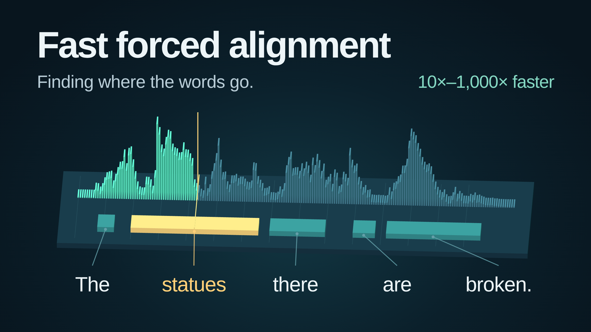

# Fast Forced Aligner

**Turn CTC frame scores and a known transcript into batched GPU alignments.**

`fast_forced_aligner` takes your model's log probabilities and transcript token
IDs, then returns a token label and score for every audio frame. Use your existing
CTC model, batch recordings of different lengths without padding, and keep the
results on the GPU. Both an optimized alignment kernel and conventional CTC
dynamic programming are included behind the same Python API.

The package provides forced alignment from existing CTC emissions. Acoustic
inference belongs to the caller's model; the examples use stock Hugging Face
Transformers models to produce those emissions.

On our ten-workload benchmark suite, with **prevalidated inputs**, optimized
alignment is **11.50× faster than corrected ctc-forced-aligner CPU8**
and **208.18× faster than k2 CUDA**.

Optimized alignments match conventional DP on all 3,482
distinct benchmark inputs; [adversarial near-tie cases can differ](#accuracy-relative-to-conventional-dp).

[Install](#install-with-pip) · [Quick start](#align-ctc-emissions) ·
[Throughput](#higher-throughput-loops) ·
[Coming from TorchAudio](#coming-from-torchaudio) ·
[How it works](#how-the-speedups-work) · [Benchmarks](#performance) ·
[Accuracy](#accuracy-relative-to-conventional-dp) · [Citation](#citation) ·
[GitHub](https://github.com/brthor/fast-forced-aligner)


## Install with pip

With Python 3.11+, Git, a compatible NVIDIA driver, and the CUDA 12.8 development
toolkit installed:

```bash
python -m pip install torch==2.8.0 --index-url https://download.pytorch.org/whl/cu128
python -m pip install "fast_forced_aligner @ git+https://github.com/brthor/fast-forced-aligner.git"
```

The package is not yet on PyPI; this installs directly from GitHub. For a
reproducible installation, append `@FULL_COMMIT_SHA` to the `.git` URL, replacing
`FULL_COMMIT_SHA` with the commit you want. CUDA
source is bundled and compiled on first use, requiring **`nvcc` and a C++ compiler**.
PyTorch's CUDA runtime alone is insufficient. The
[stock-model Docker example](examples/transformers_ctc/README.md) provides the
toolchain in a PyTorch development image. See [build requirements](#cuda-build-and-environment)
for the tested environment and cache configuration.

## Align CTC emissions

```python
import torch
from fast_forced_aligner import align

# Replace these illustrative tensors with your model's log probabilities and
# transcript token IDs. Each list element is one unpadded recording.
emissions = [torch.randn(n, 32, device="cuda").log_softmax(-1) for n in (500, 320)]
targets = [
    torch.tensor(ids, dtype=torch.int64, device="cuda")
    for ids in ([3, 7, 7, 12], [4, 9, 2])
]

result = align(emissions, targets, blank_id=0)
result.raise_for_status()
path = result.paths[0]  # CUDA int64 [500], including blanks and repetitions

# Select conventional full-record DP through the same interface.
reference = align(emissions, targets, blank_id=0, mode="conventional")
reference.raise_for_status()
```

Inputs must be contiguous CUDA FP32 emissions and CUDA int64 target IDs on one
device. Use the blank ID and transcript tokenizer from the model that produced
the emissions. Outputs retain blanks and repeated labels; each `result.paths[i]`
is a view of that recording's frame labels. This quick start uses default input checks.

**Try real audio:** the [stock Transformers example](examples/transformers_ctc/README.md)
installs the package with pip in a PyTorch development image, uses the standard
`facebook/wav2vec2-base-960h` model, streams LibriSpeech examples, and reports
alignment rows/second:

```bash
git clone https://github.com/brthor/fast-forced-aligner.git
cd fast-forced-aligner
./examples/transformers_ctc/run.sh build
./examples/transformers_ctc/run.sh --rows 4
```

Docker with NVIDIA GPU support is required. See the
[Dockerfile](examples/transformers_ctc/Dockerfile) for installation and
[align.py](examples/transformers_ctc/align.py) for the model-to-alignment flow.
Model inference is outside its alignment timer.

## Higher-throughput loops

For throughput, submit several batches before checking their statuses. This
example keeps up to eight results pending and copies their statuses to the CPU
together, so there is one completion check per window instead of one per call.
It still checks every result before yielding it, including the final partial window.

```python
from collections.abc import Iterable, Iterator
from itertools import islice, repeat

import torch
from fast_forced_aligner import AlignmentBatch, align

Batch = tuple[list[torch.Tensor], list[torch.Tensor]]


def align_stream(batches: Iterable[Batch], *, blank_id: int = 0) -> Iterator[AlignmentBatch]:
    """Align batches on one CUDA device and stream, deferring host checks."""
    batches = iter(batches)
    while window := list(islice(batches, 8)):
        pending = [
            align(emissions, targets, blank_id=blank_id)
            for emissions, targets in window
        ]
        statuses = torch.cat([result.status for result in pending]).cpu().tolist()
        failed = [i for i, status in enumerate(statuses) if status != 0]
        if failed:
            raise RuntimeError(f"Alignment failed at recording indices {failed} within this window")
        yield from pending


# Demonstration: reuse the quick-start inputs.
for result in align_stream(repeat((emissions, targets), 16)):
    paths = result.paths  # Consume the checked CUDA paths here.
```

In a real pipeline, replace `repeat(...)` with your batch iterator. Default target
validation runs on the GPU without a host wait; invalid targets and insufficient
frame counts are reported by the same status check as alignment failures. Use
`check_inputs=False` only when your pipeline already guarantees the
[input contract](#validation-and-repeated-processing) for **every batch**.
Keep inputs and processing on the same CUDA device and stream for this example.
Larger batches and fewer host waits can improve throughput, at the cost of more
pending output memory and later error reporting. Eight calls per window is an
illustrative choice, not a measured optimum.

## Coming from TorchAudio

Both functions below accept the same list of CUDA emissions and target tensors,
and return one `(labels, scores)` pair per recording, each with shape `[frames]`.
TorchAudio 2.8's `functional.forced_align` supports one recording per call, so
its function loops over the batch; Fast Forced Aligner processes the batch in
one call. The [TorchAudio 2.8 API is deprecated](https://docs.pytorch.org/audio/2.8/generated/torchaudio.functional.forced_align.html);
this comparison is for users familiar with that interface. It requires TorchAudio
2.8.0 built for the same PyTorch/CUDA environment; the core package does not
depend on TorchAudio.

```python
import torch
import torchaudio
from fast_forced_aligner import align


def align_ours(
    emissions: list[torch.Tensor], targets: list[torch.Tensor], blank_id: int = 0,
) -> list[tuple[torch.Tensor, torch.Tensor]]:
    result = align(emissions, targets, blank_id=blank_id)
    result.raise_for_status()
    return list(zip(result.paths, result.scores.split(result.lengths), strict=True))


def align_torchaudio(
    emissions: list[torch.Tensor], targets: list[torch.Tensor], blank_id: int = 0,
) -> list[tuple[torch.Tensor, torch.Tensor]]:
    results = []
    for log_probs, tokens in zip(emissions, targets, strict=True):
        labels, scores = torchaudio.functional.forced_align(
            log_probs.unsqueeze(0), tokens.unsqueeze(0), blank=blank_id,
        )
        results.append((labels[0], scores[0]))
    return results


emissions = [torch.randn(n, 32, device="cuda").log_softmax(-1) for n in (500, 320)]
targets = [
    torch.tensor(ids, dtype=torch.int64, device="cuda")
    for ids in ([3, 7, 7, 12], [4, 9, 2])
]
ours = align_ours(emissions, targets)
theirs = align_torchaudio(emissions, targets)
print(ours[0][0].shape, theirs[0][0].shape)  # both torch.Size([500])
```

The keyword `blank` becomes `blank_id`. Each unpadded tensor supplies its own
length, so our API needs no separate length arrays. Both outputs retain blanks
and repetitions, and scores are the selected input emission at each frame.
Matching output formats do not promise identical paths near numerical ties;
see [accuracy](#accuracy-relative-to-conventional-dp). To select our full-record
DP kernel, add `mode="conventional"` to the `align` call.

## How the speedups work

There are two contributions: efficient batched CUDA execution, and an optimized
algorithm that can avoid much of the full-record DP work. Both kernels start
from the same emissions and transcript, construct the CTC topology, and return
complete frame paths and selected scores.

| Mode | Computation | When to use it |
| --- | --- | --- |
| `optimized` (default) | Parallel chunks, greedy shortcuts, boundary repair, and full-record DP fallback | High aggregate throughput; review the numerical differences below |
| `conventional` | Full-record CTC Viterbi DP with optimized CUDA execution | The ordinary full-record FP32 recurrence is required |

### Conventional: efficient execution of full-record DP

The transcript is expanded with blanks into a CTC state sequence. The kernel
advances the full recurrence through the recording, then recovers the frame path.
It batches variable-length recordings on the GPU, reads their resident emissions,
and uses specialized CTC kernels with parallel traceback for long recordings.
The specialized implementation avoids constructing a general-purpose FSA graph.

This execution layer is useful on its own: conventional mode processes the
benchmark suite in **58.91 ms**, versus **349.97 ms** for corrected CPU8 and
**6,337.72 ms** for k2 CUDA, with the timing scope described below.
The large speedups over external toolkits therefore reflect implementation and
batching improvements as well as reduced DP work. They are not a measurement of
the chunking algorithm's contribution alone.

### Optimized: skip work when chunks can be joined

Optimized mode solves relaxed **128-frame chunks in parallel**. Eligible greedy
paths bypass chunk DP; other chunks use the recurrence. The kernel checks joins,
repairs connected incompatible regions, and falls back to full-record DP when
needed. Bounded repair, overlapping fallback work, and reuse of compatible
complete DP frontiers reduce repeated computation. Both modes use parallel
long-path traceback where applicable.

On the complete benchmark suite, this gives a further **1.93× speedup over our
conventional kernel**. The benefit depends on the emissions and transcript:
repair and fallback can cost more than a direct conventional pass, and optimized
mode loses on some genuine long-recording workloads. Different FP32 accumulation
orders can also change paths near ties. The following results include those
workloads and separately quantify adversarial numerical differences.

## Performance

These measurements use the **tested 0.1.0 package**, an RTX 3090 24 GiB, and a
Ryzen 7 5800XT, with PyTorch 2.8.0 and CUDA 12.8. Every implementation processes
the same **10 benchmark workloads: 3,553 input entries, representing 3,482 distinct
emission/transcript/blank inputs**, with a batch limit of **64**.

**Aggregate speedup = comparator total time / optimized total time.** Total time
is the sum of mean processing times for all 10 workloads, with six measured runs
per workload after warmup. This measures the time to process the complete suite;
it does not give a tiny dataset the same weight as a large one by averaging their
speedup ratios. Slow observations are included.

| Implementation | Mean total time | Optimized speedup |
| --- | ---: | ---: |
| Fast Forced Aligner — optimized | 30.44 ms | 1.00× |
| Fast Forced Aligner — conventional DP | 58.91 ms | 1.93× |
| ctc-forced-aligner, corrected CPU / 8 workers | 349.97 ms | 11.50× |
| ctc-forced-aligner, upstream CPU | 1,782.99 ms | 58.57× |
| TorchAudio CPU | 2,694.28 ms | 88.50× |
| TorchAudio CUDA | 6,001.72 ms | 197.14× |
| k2 CUDA | 6,337.72 ms | 208.18× |
| NeMo Viterbi CPU / 8 threads | 41,026.61 ms | 1,347.60× |
| NeMo Viterbi CUDA | 59,420.43 ms | 1,951.79× |

**NeMo configuration comparison.** The main table uses B64 in input order.
The chart uses the separately confirmed bucketed-B64 results below. Five
full-suite pilot configurations compare input-order batches 1, 16, and 64 with
length-bucketed batches 16 and 64. CPU and CUDA both select bucketed B64; each
receives six fresh measurements per workload. Sorting, padding, and restoring
output order are included in timing. Selection uses total suite time, without
mixing per-workload winners. Tuning and confirmation reuse the frozen inputs.

| Implementation | Selected schedule | Mean total time | Optimized speedup |
| --- | --- | ---: | ---: |
| NeMo Viterbi CPU / 8 threads | B64, length-bucketed | 18,892.84 ms | 620.57× |
| NeMo Viterbi CUDA | B64, length-bucketed | 28,182.72 ms | 925.72× |

Bucketing improves NeMo's CPU and CUDA totals by **2.17×** and
**2.11×**, respectively, against their fresh input-order controls.
These are the best schedules in this bounded sweep, not a claim of exhaustive
toolkit tuning. Both tables use the same frozen package build and hardware.

The suite includes LibriTTS and LibriSpeech speech, character and subword
vocabularies (32, 148, and 1,025 labels), continuous Earnings22 excerpts,
concatenated long inputs, and synthetic frame-length/tie cases. Some workloads
share audio or inputs. The continuous excerpts include recordings of roughly
45–60 seconds. Optimized mode can lose to conventional DP on these long-recording
workloads; the aggregate includes those losses.

### What the timer includes

Inputs start on the method's device. Timing includes the public alignment call,
per-call layout/topology or graph construction, allocation, internal transfers,
recurrence, traceback, and synchronization until complete frame outputs are
ready. No prebuilt graphs, padded inputs, or cached alignments are supplied to a
measured call. Acoustic inference, initial device placement,
first-use compilation, and output copies used only for auditing are excluded.

The chart and main table use **already-validated inputs**:
`align(..., check_inputs=False)`. Input admission is performed before timing for
all methods; a toolkit's own internal checks remain included. Default target
validation runs asynchronously during GPU input preparation. Its overhead is
not represented by these unchecked timings; a full-suite measurement with the
current default validation is pending. The benchmark runner provides
`optimized-checked` and `conventional-checked` lanes for that comparison.

Retain the default checks unless your pipeline already guarantees valid target
IDs and sufficient frames. Disabling validation does not skip the per-call
algorithm preparation included in these timings.

### Compared implementations

- **TorchAudio 2.8.0 CPU/CUDA:** `functional.forced_align`, called serially because
  the API accepts one recording at a time.
- **k2 CUDA 1.24.4.dev20260625**, commit `4ef277c4`: standard CTC graphs,
  `intersect_dense` with output beam 10, and shortest-path recovery. Graph
  construction, device-resident ragged transcript preparation, and nonzero-blank
  conversion are timed. Transcripts do not round-trip through CPU lists.
- **NeMo Viterbi**, commit `9bd9a949`: the isolated, unmodified alignment function,
  with eight Torch threads for CPU and batched execution for CUDA.
- **ctc-forced-aligner C++**, commit `64293cc6`: unchanged upstream serial CPU
  implementation, compiled with `-O3`.
- **Corrected C++ / CPU8:** a separately identified adaptation of the same source,
  correcting predecessor ties and frame-zero traceback, releasing the GIL, and
  using eight persistent independent-record workers.

Across this benchmark suite, all 234,498 audited outputs are valid and have the
same path score as conventional DP. k2 returns alternative equal-score paths on
the eight flat-tie input entries (48 outputs over six runs); all other output
paths match the conventional reference.
Including the NeMo pilots and selected-schedule confirmations, all **312,664**
audited outputs are valid and score-equivalent to conventional DP.

These are measurements of the specified implementations and hardware, not a
universal speedup or an end-to-end speech-recognition comparison.

### Reproduce the comparison

The [benchmark subproject](benchmarks/README.md) provides a pinned Docker
environment, all 11 comparison lanes, public-data regeneration, per-output
accuracy auditing, and report generation. Stock Transformers and NeMo models
generate cached emissions from public datasets using their unmodified forward
methods. Every comparator receives the same inputs, and model inference is
outside the alignment timer. No hosted input bundle is required.

```bash
./benchmarks/run.sh build
./benchmarks/run.sh build-prepare
./benchmarks/run.sh prepare
./benchmarks/run.sh run
./benchmarks/run.sh report
```

Model revisions and recording selections are fixed; small numerical differences
across machines are expected. New runs write local measurements and figures
without replacing the historical results above. Detailed reports and raw results are excluded from Git and package builds.
See the [benchmark instructions](benchmarks/README.md) for input provenance,
timing boundaries, hardware controls, and the distinction between full-suite
reproduction and a smaller local experiment.

For a small local timing example:

```bash
python examples/benchmark.py --rows 1024 --batch-size 256 --repeats 10
python examples/benchmark.py --rows 1024 --batch-size 256 --check-inputs
```

This example uses synthetic inputs and reports whole-dataset time and rows/second.
The second command repeats admission checks inside every timed call.

## Accuracy relative to conventional DP

The shipped optimized kernel was assessed on **3,482 distinct
emission/transcript/blank inputs**, including real speech, long recordings,
subword emissions, and synthetic cases. Six passes over the suite provide
21,318 optimized outputs; repetitions and overlapping inputs are not independent
accuracy samples.

| Metric relative to conventional FP32 DP | Observed result |
| --- | ---: |
| Exact frame-label and selected-score agreement | 100% |
| Additional path score loss | 0 |
| Token start/end displacement | 0 frames |
| Invalid paths or failed alignments | 0 |

Optimized mode is **not universally bitwise equivalent** to conventional FP32 DP.
A separate check of both packaged modes on 138 deliberately adversarial inputs
finds:

| Outcome | Inputs |
| --- | ---: |
| Identical successful paths | 121 |
| Higher-scoring valid optimized paths | 11 |
| Lower-scoring valid optimized paths | 3 |
| Matching failure statuses | 3 |

On the three lower-scoring cases, maximum additional total score loss is
**0.0000534058** (maximum loss per frame: **2.29 × 10⁻⁷**), and maximum token-boundary
displacement is **132 frames**. Score loss is the conventional path's sum minus
the optimized path's sum, computed exactly from the supplied FP32 emissions.
Across all differing paths, including higher-scoring ones, the maximum boundary
displacement is **145 frames**. A small score difference does not guarantee a
small timestamp difference.
The 32 normalized near-tie cases produce 28 identical and four higher-scoring
paths, with no lower-scoring paths. The matching failures comprise two extreme
FP32 accumulation overflows and one all-negative-infinity input.

These artificial cases do not estimate real-speech error rates. Use
`mode="conventional"` when the ordinary full-record recurrence is required.
Both modes retain FP32 rounding/overflow limitations. Human-annotated timestamp
accuracy has not been evaluated; these metrics measure agreement with conventional
DP on the same emissions and transcript.

## API details

### Input and output contract

- Emissions are contiguous CUDA FP32 `[frames, vocabulary]` tensors; targets are
  contiguous CUDA int64 `[tokens]` tensors. All inputs share one device.
- Records may have different frame counts, transcript lengths, and vocabularies.
  `blank_id` accepts one integer or one integer per record.
- Targets contain in-vocabulary, nonblank IDs. Adjacent repeated targets need
  intervening blank frames. Empty transcripts are supported; empty emissions
  are rejected. Limits are 2,047 target tokens, vocabulary size 8,192, and 65,535
  records per call. Available GPU memory usually imposes tighter batch limits.
- Emissions may contain finite scores or negative infinity, but not NaN or
  positive infinity. Default checks validate targets and frame feasibility;
  they do not scan entire emission matrices for nonfinite values. The optional
  `emission_validity()` scan and `align(..., emission_validity=mask)` exclude
  invalid records on the GPU without a host synchronization.
- `result.paths` provides per-record CUDA views. `result.labels` and
  `result.scores` pack all frame labels and selected emissions in input order.
  Split scores with `result.scores.split(result.lengths)` for per-record views.
  Status zero means success; status one means no finite complete path was
  produced, including FP32 accumulation overflow. Status two means the optional
  emission-validity mask rejected that input before alignment. Status three
  means invalid target IDs; status four means insufficient CTC frames. Target
  validation errors take precedence over the emission mask. Failed records contain labels
  of `-1` and scores of negative infinity. `raise_for_status()` synchronizes
  status and raises for failed records.
- Alignment is inference-only. Execution uses the current CUDA stream; order
  producers on other streams before calling `align`, establish dependencies
  before consuming outputs on another stream, and do not mutate inputs during
  execution. Returning CUDA tensors does not imply GPU work has completed.

The [Python interface docstrings](src/fast_forced_aligner/alignment.py) describe
every argument, output field, diagnostic tensor, and exception. They are also
available through `help(align)` and `help(AlignmentBatch)` after importing those
symbols from `fast_forced_aligner`.

### Validation and repeated processing

Default validation checks metadata immediately, then checks target IDs and
minimum CTC frame counts on the GPU without waiting on the host. Rejected
records skip alignment safely; inspect `result.status` or call
`result.raise_for_status()` at your completion boundary.

For trusted inputs, `check_inputs=False` skips the GPU target checks. The
standalone `validate_inputs()` helper is still available when an **immediate,
synchronous** input check is useful, such as validating fixed inputs once:

```python
from fast_forced_aligner import align, validate_inputs

validate_inputs(emissions, targets, blank_id=0)
result = align(emissions, targets, blank_id=0, check_inputs=False)
result.raise_for_status()
```

This snippet uses `emissions` and `targets` from the quick start. Validation may
be reused while target IDs, tensor shapes, and blank IDs remain valid; changed
inputs must still satisfy the documented contract. Topology construction,
allocation, alignment, and traceback occur on every call. Invalid target IDs
must never reach the native kernel with checking disabled. Validation does not
scan emission values or guarantee a finite-scoring complete path.

### Device-side emission validation

For streaming processing, scan numeric emission
values and gate invalid records without waiting for a result on the CPU:

```python
from fast_forced_aligner import align, emission_validity

validity = emission_validity(emissions)
result = align(emissions, targets, emission_validity=validity)
# At the normal completion boundary, inspect validity and result.status.
```

The scan accepts finite values and negative infinity, and rejects any NaN or
positive infinity anywhere in a recording. A false mask entry skips greedy
shortcuts, dynamic programming and repair, producing status two unless target
validation detects invalid IDs (three) or insufficient frames (four). Rejected
records have labels -1 and scores/objective negative infinity. Valid records retain normal alignment
behavior; in particular, an all-negative-infinity record is numerically valid
but has no finite path (status one). Target validation is independent: do not
turn it off unless targets and frame feasibility are already validated.

The mask can cover all acoustic model outputs, including recordings without an
alignable target. Select its entries in the same order as the records passed to
alignment and retain the full mask to control emission persistence. Inputs must
remain unchanged between scanning and alignment; observe CUDA stream ordering.
Supplying a mask asserts that its true entries satisfy numeric preconditions.
`raise_for_status()` remains an optional host synchronization at completion.

### Converting frame labels to timestamps

Split a path into equal-label runs, discard blank runs, and retain each remaining
run's start and exclusive end frame. Multiply by the model's frame stride in
seconds to obtain timestamps. Blank-separated repeated tokens remain separate
occurrences. The stock Transformers example uses
`model.config.inputs_to_logits_ratio / sample_rate` seconds per frame.
Timestamp quality also depends on the model and transcript; alignment does not
provide a universal frame-to-audio mapping for every model.

## CUDA build and environment

The tested configuration is Linux, Python 3.11, PyTorch 2.8.0, CUDA 12.8, and
RTX 3090. Execution requires an NVIDIA GPU/driver, the CUDA development toolkit
with `nvcc`, and a compatible C++ compiler. The wheel contains CUDA source and
compiles it on first use; pip installation and import do not require a GPU.
Other platforms and PyTorch/CUDA versions have not been qualified.

Compilation uses PyTorch's persistent extension cache. Set `CUDA_HOME` if the
toolkit cannot be found, `TORCH_EXTENSIONS_DIR` for a writable cache directory,
and `MAX_JOBS` to limit compilation parallelism. To compile/load before processing:

```bash
python -c "from fast_forced_aligner import load_extension; load_extension()"
```

## Build a distribution

From a repository checkout (use `python -m pip install .` to install that local
source directly):

```bash
python -m pip install build
python -m build
```

The wheel and source archive appear in `dist/`. CUDA compilation happens on the
user's first alignment call, so building these distributions does not require a
GPU. Install the wheel in an environment with the execution requirements above.

The package is pre-release.

## License

Fast Forced Aligner's original code and documentation are licensed under the
[MIT License](LICENSE). Copyright 2026 Bryan Thornbury.

The bundled C++ benchmark comparator retains its
[BSD-2-Clause license](benchmarks/patches/LICENSE.ctc-forced-aligner).
[NOTICE](NOTICE) identifies the third-party code and its provenance. Distribution
metadata lists both licenses to account for the comparator in the source archive.

Report bugs or request features in the
[GitHub issue tracker](https://github.com/brthor/fast-forced-aligner/issues).

## Citation

If you use Fast Forced Aligner in your research, please cite the software:

```bibtex
@software{thornbury2026fastforcedaligner,
  author  = {Thornbury, Bryan},
  title   = {{Fast Forced Aligner}},
  year    = {2026},
  version = {0.1.0},
  url     = {https://github.com/brthor/fast-forced-aligner}
}
```

Please also report the version or commit used for your experiments. The
[CITATION.cff](CITATION.cff) file provides citation metadata for GitHub's
**Cite this repository** feature.
