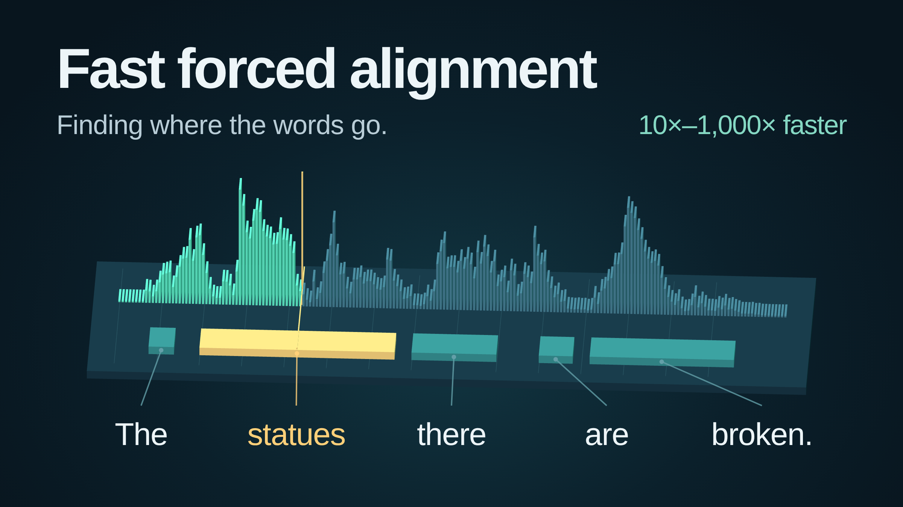

# Fast Forced Aligner: Batched CUDA Alignment for Speech Datasets



By Bryan Thornbury. Adapted from [Fast Forced Alignment: Finding Where the Words Go](https://bryanthornbury.com/posts/fast-forced-alignment/), which includes interactive explanations and an audio example.

**[Get the code on GitHub](https://github.com/brthor/fast-forced-aligner)** · **[Run the stock Transformers example](https://github.com/brthor/fast-forced-aligner/tree/master/examples/transformers_ctc)**

Suppose you have an audio recording and its transcript. You already know what was said. What you want to know is **when each word was said**.

That is forced alignment. It is useful for making subtitles, finding a phrase in a recording, and preparing audio/text pairs for speech-model training. Across a large dataset, the alignment computation itself can become worth optimizing.

We built **Fast Forced Aligner**, a set of CUDA kernels that takes CTC frame scores and a known transcript and returns an alignment. On our ten-workload benchmark suite, optimized mode processes the alignment workload in **30.44 milliseconds**, compared with **6.34 seconds for k2 CUDA** and **28.18 seconds for NeMo's CUDA Viterbi implementation with length-bucketed batches**: roughly **208× and 926× faster**.

These are alignment-only measurements on an RTX 3090, with inputs already on each method's device and admitted before timing. Acoustic-model inference is excluded. The package works with the emissions from an existing CTC model; the model can stay exactly the same.

The speedup has two layers: execute conventional dynamic programming efficiently, then find opportunities to do less of it.

## From words to timestamps

“Forced” means that we supply the transcript. A speech recognizer decides what was said; an aligner finds a timing arrangement consistent with the supplied text. An incorrect transcript can therefore produce poor timestamps.

The pipeline has two main pieces:

```text
Audio → CTC acoustic model → Frame scores
                                  + Known transcript tokens
                                  ↓
                           Alignment kernel
                                  ↓
                         Frame labels and scores
```

The acoustic model turns the waveform into a sequence of scores. The alignment algorithm uses those scores and the transcript to assign labels to frames. Token spans and word timestamps can then be assembled from that frame path.

For a concrete listening example, the [interactive version of this article](https://bryanthornbury.com/posts/fast-forced-alignment/#putting-words-on-a-timeline) lets you select individual words in “Let me see: I'll give them a new pair of boots every Christmas” and hear their aligned intervals.

## A little CTC intuition

CTC stands for *Connectionist Temporal Classification*. A recording may contain hundreds of frames but only a few dozen transcript tokens. A vowel can span several frames, and different speakers say the same sentence at different speeds.

A CTC model produces scores for each token at each frame, including a special **blank** token. The tokens may be characters or larger pieces of words. To turn a frame sequence into text, CTC merges adjacent repeated labels, then removes blanks:

```text
Frame labels:   — C C C — A A — T T —
Merge repeats:  — C — A — T —
Remove blanks:    C A T
```

Blank is neither a literal space nor necessarily silence. It contributes no transcript token.

To spell **BOOK**, the two O's need a blank between them. Otherwise, adjacent O labels merge into one:

```text
B O O O K  → BOK
B O — O K  → BOOK
```

Alignment therefore needs a **complete path through the frame scores that collapses to the supplied transcript**. Picking the highest-scoring token independently at each frame can violate that constraint.

Conventional CTC alignment uses dynamic programming, often called the CTC Viterbi recurrence. At each frame, it retains the best accumulated score for each transcript state. Legal transitions allow staying in place, advancing one state, or skipping a blank between different tokens. Traceback recovers the selected frame path.

This avoids enumerating every possible path, but still involves a grid of roughly **frames × transcript states**.

## First, make conventional DP fast

The package includes a conventional mode that evaluates the ordinary full-record FP32 recurrence. It already benefits from specialized CUDA execution:

- **Represent CTC transitions directly.** Transcript tokens and interleaved blanks describe the small set of legal transitions. A specialized implementation avoids the general-purpose graph construction and intersection used by the tested k2 adapter.
- **Keep the frame loop inside the kernel.** A GPU block advances through a recording while its threads update transcript states together. Two live score rows stay in shared memory, and compact predecessor information supports traceback.
- **Batch variable-length recordings without padding their emissions.** Blocks work on different recordings concurrently and read their existing tensors. Call and launch overhead are shared across recordings.
- **Recover paths on the GPU.** Long paths use traceback summaries and parallel section recovery, keeping the output on the device.

Together, these choices bring conventional mode to **58.91 ms** across the suite. Much of the advantage over the tested toolkits is already present before introducing the chunking algorithm.

## Then, reduce the work with parallel chunks

Conventional DP advances through time sequentially: each frame depends on the previous frame. Optimized mode adds parallelism within a recording:

1. **Solve local chunks in parallel.** Split the recording into 128-frame chunks and initially relax the constraints connecting them. Eligible chunks use a greedy shortcut; the others use local DP.
2. **Check joins and repair conflicts.** Compatible local paths can be assembled. Incompatible neighboring chunks are grouped into regions and recomputed together. Compatible saved DP frontiers can reduce repeated work as regions grow.
3. **Fall back when necessary.** If joins cannot be resolved within the repair strategy, evaluate full-record DP.

On the complete suite, optimized mode reduces total time from **58.91 ms to 30.44 ms**, a further **1.93× speedup** over our conventional kernel. The larger gains over external toolkits combine specialized CUDA execution, batching, and reduced DP work.

The [interactive algorithm comparison](https://bryanthornbury.com/posts/fast-forced-alignment/#then-reduce-the-work-with-parallel-chunks) illustrates compatible chunks, local repair, and full-record fallback.

## How much faster?

The suite contains **3,553 entries across ten workloads**, representing **3,482 distinct emission/transcript/blank inputs**. It covers LibriTTS, LibriSpeech, continuous Earnings22 excerpts, concatenated long recordings, character and subword vocabularies, and synthetic cases. Some workloads overlap.

Hardware is an **RTX 3090 with 24 GiB** and an **AMD Ryzen 7 5800XT with 8 cores / 16 threads**. The batch limit is 64. Each total sums the mean processing time for each workload, using six measured runs per workload after warmup. Speedup is the ratio of aggregate times, rather than an average of individual workload speedup ratios.


| Implementation | Mean total alignment time | Speedup of optimized mode |
| --- | ---: | ---: |
| Fast Forced Aligner: optimized | 30.44 ms | 1.00× |
| Fast Forced Aligner: conventional DP | 58.91 ms | 1.93× |
| ctc-forced-aligner: corrected CPU, 16 workers | 332.64 ms | 10.93× |
| TorchAudio CPU | 2,694.28 ms | 88.50× |
| k2 CUDA | 6,337.72 ms | 208.18× |
| NeMo Viterbi CUDA: B64, length-bucketed | 28,182.72 ms | 925.72× |

The CPU16 row comes from a separate full-capacity follow-up on the same suite and hardware. The corrected C++ implementation fixes predecessor ties and frame-zero traceback, adds input guards, and releases the GIL for independent-record parallelism. Its patch is public. NeMo uses the best schedule found in a bounded batch-size/order sweep, followed by fresh confirmation measurements; sorting and restoring output order are timed. [Full results and CPU worker comparison](https://github.com/brthor/fast-forced-aligner/blob/master/benchmarks/RESULTS.md).

**The timer includes** per-call layout preparation, graph/topology construction where needed, allocations, alignment, traceback, internal transfers, and synchronization until outputs are ready. Initial device placement, compilation, warmup, acoustic inference, and output copies used only for auditing are excluded.

The headline timings use prevalidated inputs and `check_inputs=False` for our kernels. Toolkit-internal checks remain included. The default API performs asynchronous input checks; the benchmark has separate checked lanes for measuring that path. The usage examples below retain the defaults.

These are comparisons of the specified implementations and execution strategies. For example, TorchAudio 2.8's tested alignment interface accepts one recording per call, while our API accepts variable-length batches. The measurements describe the complete alignment operation under the stated contract, not an end-to-end ASR speedup.

### When optimized is slower

Trying to avoid work has a cost. Chunk computation, join checks, repair, and fallback can take longer than starting with full-record DP. The published comparison includes these three continuous-long panels, with recordings roughly 45–60 seconds long:

| Long-audio panel | Conventional | Optimized |
| --- | ---: | ---: |
| Initial held-out recordings | 3.08 ms | 3.15 ms |
| Fresh recordings | 4.20 ms | 6.16 ms |
| Additional fresh recordings | 4.26 ms | 4.35 ms |

These are total panel times. The slowdowns range from about **2% to 47%**, and they remain included in the aggregate results. Duration alone does not predict the result: different long-audio populations behave differently.

Both kernels share the same API. Use `mode="conventional"` when your workload favors the full-record recurrence.

## Does the alignment change?

Across the **3,482 distinct benchmark inputs**, optimized and conventional modes returned identical frame labels and selected scores, with no token-boundary displacement or additional path-score loss.

That is measured agreement, not universal bitwise equivalence. Chunking changes floating-point accumulation order. A separate 138-case adversarial study found 121 identical successful paths, 11 higher-scoring valid optimized paths, three lower-scoring valid optimized paths, and three matching failure statuses.

The maximum additional total score loss on the lower-scoring cases was **0.0000534058**, evaluated by exact summation of the supplied FP32 scores along the selected paths. Across all differing paths, boundary displacement reached **145 frames**. A small score difference does not guarantee a small timestamp difference.

Conventional mode is available when the ordinary full-record FP32 recurrence is required. Both modes retain floating-point rounding and overflow limitations. These measurements assess agreement with conventional DP; they do not measure accuracy against human timestamps. The [README accuracy section](https://github.com/brthor/fast-forced-aligner#accuracy-relative-to-conventional-dp) gives the full breakdown.

## Try it with a stock Transformers model

The repository includes a small Docker example using the unmodified Transformers implementation of [`facebook/wav2vec2-base-960h`](https://huggingface.co/facebook/wav2vec2-base-960h). It streams audio and transcripts from a [small LibriSpeech example dataset](https://huggingface.co/datasets/hf-internal-testing/librispeech_asr_dummy), generates emissions, batches alignment calls, and prints alignment throughput.

With Docker, NVIDIA Container Toolkit, and a compatible NVIDIA driver:

```bash
git clone https://github.com/brthor/fast-forced-aligner.git
cd fast-forced-aligner
./examples/transformers_ctc/run.sh build
./examples/transformers_ctc/run.sh --rows 4
./examples/transformers_ctc/run.sh --rows 4 --mode conventional
```

The example installs the package with pip inside a PyTorch development image. First use downloads model/data files and compiles the CUDA extension. Later runs reuse caches. The reported throughput covers alignment, not model inference, and this small example is a usage demonstration rather than the full comparison benchmark.

For installation into an existing environment, the tested configuration uses Linux, Python 3.11+, PyTorch 2.8, and the CUDA 12.8 development toolkit, including `nvcc` and a C++ compiler:

```bash
python -m pip install torch==2.8.0 --index-url https://download.pytorch.org/whl/cu128
python -m pip install "fast_forced_aligner @ git+https://github.com/brthor/fast-forced-aligner.git"
```

The aligner consumes lists of contiguous CUDA tensors: one FP32 `[frames, vocabulary]` log-probability tensor and one int64 transcript-token tensor per recording. Recordings do not need matching lengths.

Here is the same input/output pattern expressed with our API and TorchAudio:

```python
import torch
import torchaudio
from fast_forced_aligner import align


def align_ours(emissions, targets, blank_id=0):
    result = align(emissions, targets, blank_id=blank_id)
    result.raise_for_status()
    return list(zip(
        result.paths, result.scores.split(result.lengths), strict=True
    ))


def align_torchaudio(emissions, targets, blank_id=0):
    results = []
    for log_probs, tokens in zip(emissions, targets, strict=True):
        labels, scores = torchaudio.functional.forced_align(
            log_probs.unsqueeze(0), tokens.unsqueeze(0), blank=blank_id,
        )
        results.append((labels[0], scores[0]))
    return results


# Illustrative inputs. Replace with your model's emissions and transcript IDs.
emissions = [
    torch.randn(n, 32, device="cuda").log_softmax(-1)
    for n in (500, 320)
]
targets = [
    torch.tensor(ids, dtype=torch.int64, device="cuda")
    for ids in ([3, 7, 7, 12], [4, 9, 2])
]
ours = align_ours(emissions, targets)
theirs = align_torchaudio(emissions, targets)
print(ours[0][0].shape, theirs[0][0].shape)  # both torch.Size([500])
```

Fast Forced Aligner processes the batch in one call; TorchAudio loops over recordings. The keyword `blank` becomes `blank_id`, tensor shapes supply the lengths, and the outputs stay on the GPU. `raise_for_status()` explicitly synchronizes to inspect per-record errors; throughput-oriented loops can defer it, as described in the [README](https://github.com/brthor/fast-forced-aligner#higher-throughput-loops).

Use the tokenizer and blank ID belonging to your model. Returned paths retain blanks and repeats. Token spans come from equal-label runs with blank runs removed; map frame indices to time using the model's stride. Word boundaries require assembling those token spans.

## Reproduce the comparison

The benchmark subproject regenerates emissions from pinned public datasets and stock Transformers/NeMo checkpoints. It includes the workload selections, a locked preparation environment, comparator implementations, and output auditing against conventional DP.

From the repository checkout:

```bash
./benchmarks/run.sh build
./benchmarks/run.sh build-prepare
./benchmarks/run.sh prepare
./benchmarks/run.sh verify
./benchmarks/run.sh run
./benchmarks/run.sh report
```

The default campaign uses eight CPU workers and input-order batches. To reproduce the additional configurations highlighted above:

```bash
# Full-capacity corrected CPU follow-up on a 16-logical-CPU machine.
./benchmarks/run.sh run --methods ctc-corrected --workers 16 \
    --output ./.local/cpu16

# NeMo schedule search and fresh confirmation of selected configurations.
./benchmarks/run.sh sweep --output ./.local/nemo-sweep
```

Every comparator receives the same regenerated arrays. Model inference remains outside alignment timing. Regeneration preserves the public selection and preprocessing recipe while allowing numerical differences across environments. A fresh regeneration and four-method sanity check on our machine reproduced the published aggregate times within **3%**; that check covered optimized, conventional, corrected CPU8, and k2 CUDA.

The public performance workflow audits its own outputs; the README's separate 138-case adversarial study is not included in that runner. Detailed timing boundaries, comparator versions, and hardware controls are in the [benchmark instructions](https://github.com/brthor/fast-forced-aligner/blob/master/benchmarks/README.md).

The package is MIT-licensed, with the bundled C++ benchmark comparator retaining its BSD-2-Clause license. If you use it in research, the repository includes [citation metadata](https://github.com/brthor/fast-forced-aligner/blob/master/CITATION.cff).

**[Try Fast Forced Aligner](https://github.com/brthor/fast-forced-aligner)**, and share measurements from your workloads or hardware. The most useful feedback is whether the complete alignment pass gets faster in the pipeline you actually run.
